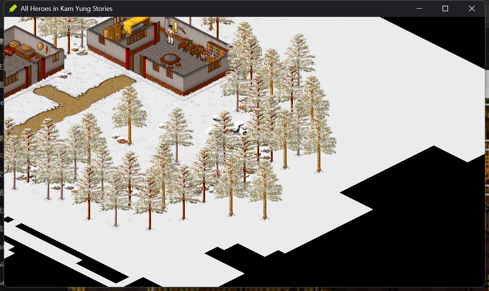

书架里那张《金庸群侠传》是 2015 年的 DOSBox 封装盘。每次想玩都要穿过一层"模拟器考古现场"：全屏黑框、像素拉伸、DOS 的四声部 MIDI。作为一个怀旧玩家这都能忍，但作为工程师我更好奇的是壳下面那套东西——于是起了个念头：**把它重构为现代 Windows 原生应用，彻底摆脱模拟器。**

这篇是阶段性复盘。游戏现在能玩了：建角色、开场剧情、大地图长距离行走全程零错图，54fps。但这中间有几段值得记下的弯路。

## 1. 先考古：封装盘里有什么

动手前先弄清手上是什么。用 [REA](https://github.com/morluto/rea) 把封装盘拆开，结论有点好笑：

- **`开启游戏.exe`（4.9MB，2015 年）= 改名的 DOSBox 0.74**。VERSIONINFO 里 OriginalFilename 还是 `dosbox.exe`，版权信息 2002-2013 DOSBox Team
- 启动链是三层 BAT：`dosbox.conf` 的 autoexec 挂载镜像 → `FPE.BAT` 先把「整人专家」游戏修改器装进内存 → 才轮到游戏本体
- 真正的主程序 `Z.EXE` 只有 343KB：Watcom C/C++ 编译的 32 位 DOS 保护模式程序，靠 DOS4GW 引导

还有一个悬案：**Z.EXE 的文件时间戳是 2011 年，不是原版的 1996**（同目录的开场动画播放器都还是 1996-10-10）。主程序被人改过，改了什么没解——这个坑留到最后说。

## 2. 考古的铲子：REA

上面这轮法证不是手工干的。这里要正面介绍下整个项目的核心反编译技术：[REA（Reverse Engineer Anything）](https://github.com/morluto/rea)。

它是一个 MCP 服务器，一句话：**把你的 Agent 接上全套逆向工具链**。原生二进制可以驱动 Hopper / Ghidra / IDA 做反编译分析，此外还覆盖 JavaScript/Electron 应用、.NET 程序集、固件和网站运行时行为——基本囊括了"看到一个软件，想知道它怎么工作"的所有形态。安装就是一句 `npx rea-agents setup`，MIT 协议。

我选它留下来当主力工具，看重的是两点设计：

- **结论必须带证据**。REA 的每个分析结论都附完整的证据链和"未知项"声明——它不会把猜测包装成事实。第 1 节那个"改名 DOSBox"的判断能实锤，靠的就是它提取的 VERSIONINFO 原始字段，而不是"看起来像"。
- **分析全部在本地跑**。老盘、私货、带 DRM 嫌疑的二进制，都不出本机。

在这个项目里它包揽了：封装盘结构分析、启动链（三层 BAT）剥析、Z.EXE 的编译器与时间戳取证，以及后面各节那些自定义二进制格式的初步打样。路线图里"反编译 Z.EXE 解 2011 修改之谜"那一步，深度反编译同样由它驱动 Ghidra 完成。

## 3. 路线：三条路

| 路线 | 内容 | 结论 |
| --- | --- | --- |
| A | dosbox-staging 现代化封装 | 还是模拟器套壳，否 |
| B | 基于开源复刻引擎 kys-cpp | **采纳** |
| C | Ghidra 反编译 Z.EXE 自研引擎 | 成本失控，否 |

[kys-cpp](https://github.com/scarsty/kys-cpp) 是社区维护多年的开源复刻：C++/SDL2，BSD-3 加金庸题材禁牟利条款（所以这事纯属自用情怀，不涉及牟利）。它自带完整的现代工程（vcpkg 依赖清单、SQLite 存档、Cifa 剧情脚本系统），我的角色是**把它和原版数据接通**，而不是从零写引擎。

## 4. 编译：工具链层面的小战役

上游工程全量 `PlatformToolset=v145`，本机 VS BuildTools 只有 v143——sed 批量降级解决。真正的硬骨头是一个百来个模板错误的编译爆炸：排查一度怀疑是依赖版本漂移，真因最后落在 **MSVC v143 对 lambda 内使用 constexpr 局部变量的 bug**，绕开即可，51 行补丁。此外还有作者机器残留的绝对路径（`C:\project\mlcc`）、漏写的依赖（libzip 在 bat 里有、readme 里没有）、以及一处「引用早已被注释掉却还挂在链接设置里的 OpenCV」。

教训一句话：**跨机器迁移别人的老工程，报错先查工程残留配置，再怀疑代码和依赖。**

## 5. 数据：三场破译

原版资源全是自定义二进制格式（GRP+IDX 成对打包、COL 调色板、Big5 文本、Miles Sound System 的 XMI 音乐），kys-cpp 只认转换后的现代格式，所以转换管线要自己打通。三场破译值得记：

**MMAP.IDX 根本不是偏移表。** 大地图贴图组 MMAP.GRP 配套的"索引"按偏移表解析会直接段错误——357MB、熵 8.0（加密或压缩数据）、解出的偏移能越界 1.5MB 的缓冲区。放弃这条路后改从 GRP 本体下手：它是自描述的 RLE 链式结构，顺着解析 3731 条**零断链、精确收在文件尾**——这就是解码正确的铁证。于是重建了一份索引表，2936 张地图 PNG 一秒出齐。

**贴图编号是分场景的局部 id。** 场景数据里引用的贴图 id，不是全局编号，而是各场景自己 SMP 文件里的局部序号。kys-cpp 用全局单组贴图，于是补了一层编址：全局 id = 场景号 × 5000 + 局部 id，引擎里单点加基址，**原版数据一个字节都不用动**。84 个子地图 47,037 张 PNG 全部自产转换。

**破译方法本身比结论有意思：** 面对未知二进制格式，别靠肉眼对比，用**内部一致性统计裁决假设**——比如"场景引用的 id 对候选区间的命中率 100%"，这比任何目检都可靠。后来这个方法又破了战场贴图（WDX/WMP 与战场 1:1 配对）的编址。

## 6. 黑屏马拉松：两次误判和一个真相

打通转换管线后游戏能跑了，但窗口全黑。这一段的排查链比想象中曲折，先记录两次自己的误判：

- **误判一**：全屏像素统计"87.7% 非黑"——统计把桌面壁纸也算进去了。像素统计必须锁定目标窗口。
- **误判二**：日志插桩后 grep 计数显示"只画了 2 帧"——`grep -c` 按行计数，而探针输出没有换行。实际是 54fps 从未卡死。

真相有两层。第一层：游戏在等一张**不存在的图**——kys-cpp 期望 `title/154.png` 作为 1280×720 全屏标题背景，但扫描全部原版 GRP 确认：**1996 年的原版标题本就是黑底红字，根本没有全屏图**，154 这个编号只存在于后来的社区资源包。第二层更物理：游戏窗口默认落在了 4K 桌面的屏幕外，可见区只有黑色顶边——那几天看到的"黑屏"有一半是它。

第一层的修复反而成了整个项目里最有情怀的一步：结局图库 KEND.GRP 里是 221 张 320×200 的裸帧，无压缩、每帧恰好 64000 字节，配原版调色板直接渲染——**1996 年的原画**。取其中一帧放大重制成标题背景，悬停按钮也从原画帧提亮生成。黑屏 Marathon 结束时，窗口里出现的是当年那枚红色 logo。

## 7. 补原版的课

- **音乐**：原版 24 首 XMI 按 ScummVM 的解析规则转成 MIDI（XMI 的事件延时编码和标准 MIDI 不同，各有一套 VLQ 变体），配 32MB 通用音色库走 FluidSynth——走进雪原那段 BGM 响起的时候，复古感是完整的。
- **存档**：读档报错的根因是槽位文件的命名规则（`s1.grp`/`d1.grp`，不是初始存档那对）——补齐后进雪原场景实测通过。
- **战斗**：战场地面错位，靠第 4 节的统计法定位到战场贴图另有专属编址；战斗角色没动作，则是 abc 工具写 `fightframe.txt` 时**目录不存在、fopen 静默失败**——103 个文件预建目录后全部生成。

## 8. 现状：能玩了

实机验收（2026-10-12）：标题 → 角色创建 → 开场剧情 → 出家门 → 大地图长距离行走，草地/沙漠/山地/水域/道路全程零错图，事件脚本触发正常，54fps。

还在清单上的：安装包打包与存档目录用户化；4in1 社区资源包合并（角色行走图对照）；物品图标（原版无来源，上游建议自选图，化妆级缺口）；以及少数空占位数据（同伴离队/升级事件）。

## 9. 未完待续

回到第 1 节那个悬案：**Z.EXE 在 2011 年被改了什么？** 路线选型时被否掉的"反编译自研"其实是留给它的——等主体收尾，让 REA 驱动 Ghidra 把这 343KB 拆开，既解谜，也能给复刻引擎补上原版的逻辑语义。

项目收尾后再来写续篇。如果你也有这样一张老盘，别让它只活在模拟器里——数据的格式是有语法的手稿，花点时间就能重新读懂。
