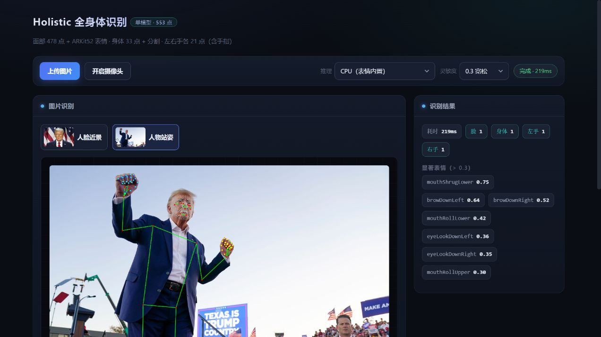
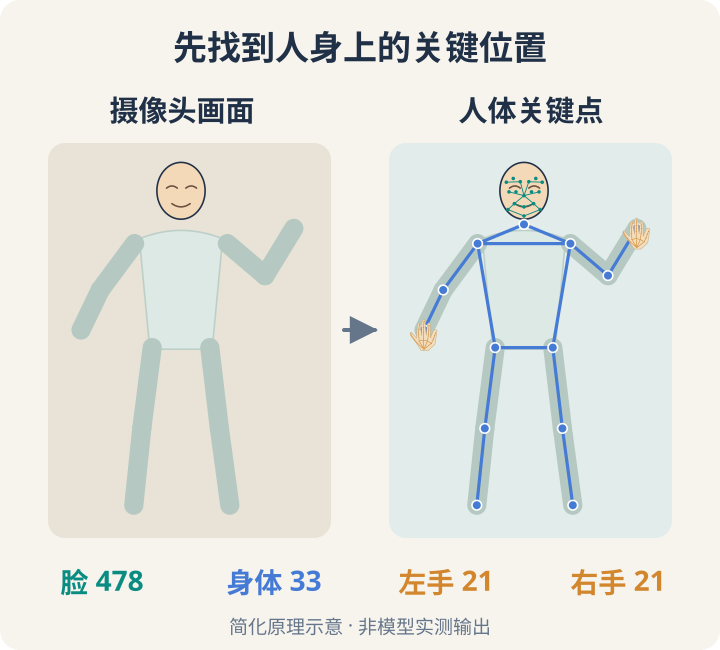
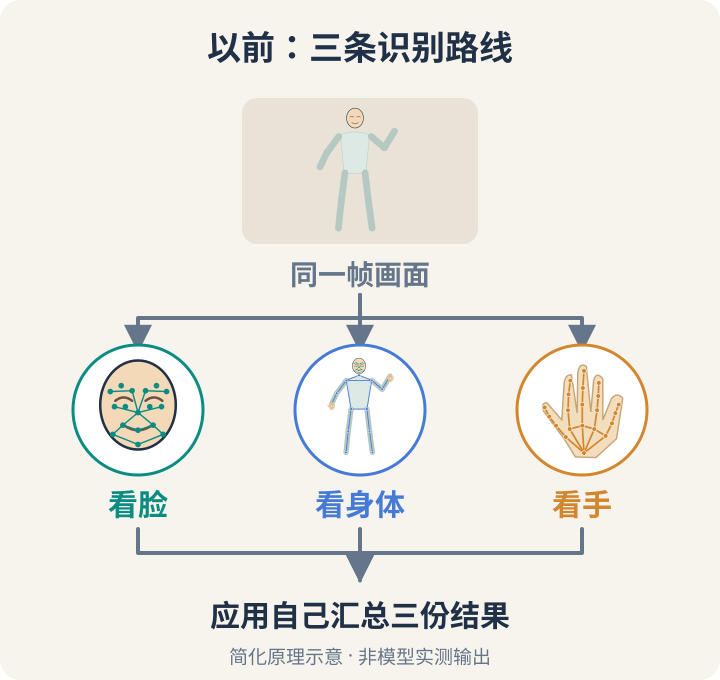
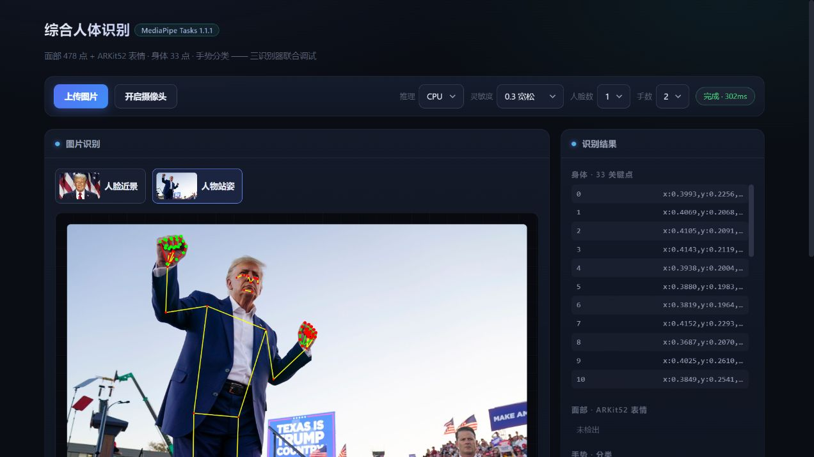
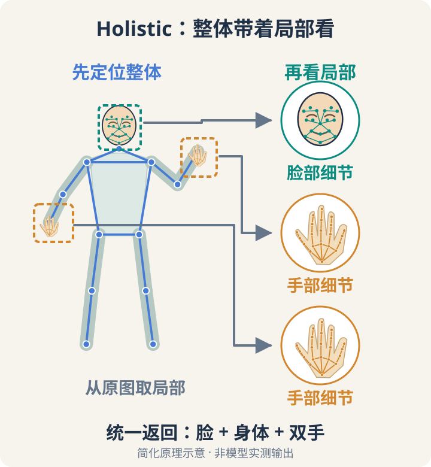
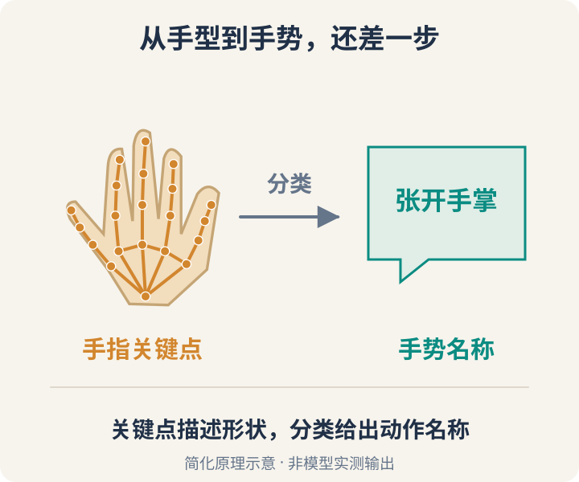
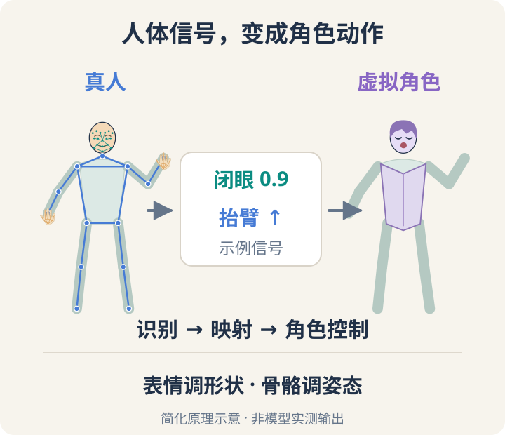
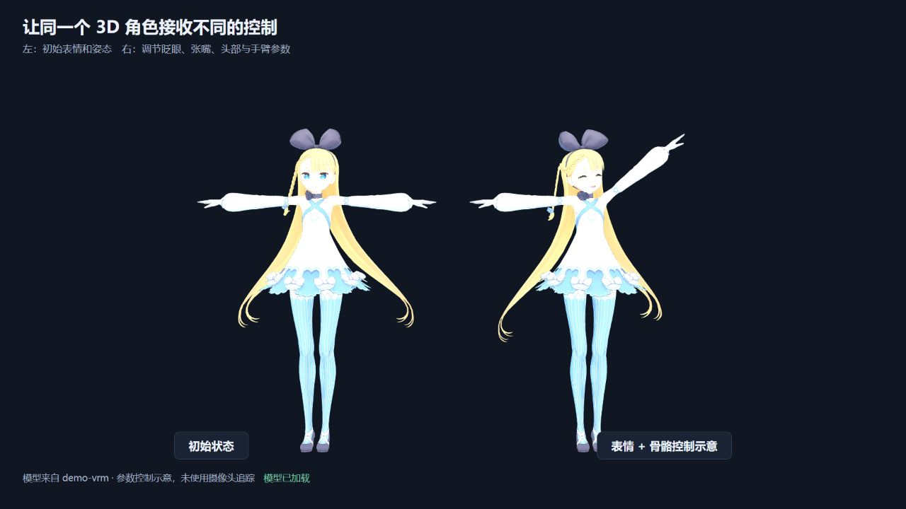

你眨一下眼、张开嘴，或者抬起手臂，摄像头拍到的只是一张张画面。AI 怎样从中找到面部表情、身体姿态和手指动作？这些数据，又怎样让一个 3D 虚拟角色动起来？

MediaPipe 是一套提供这类 AI 识别能力的工具。这次重新整理 [demo-vrm](https://github.com/yj1438/demo-vrm)，最让我开心的是：**终于又能在新版里用上现成的综合识别了——脸、身体和双手，交给同一个 Holistic（综合人体识别）任务处理。**



先看项目里的实际效果：一张示例照片，识别出了脸、身体和左右手。脸上的网格、身体的骨架线、手指上的小点，就是识别结果。下面用几张图，看看这些点怎样得到，又怎样变成角色的动作。

## 1. AI 怎样把人体变成关键点？



模型先估计眼角、肩膀、手肘、指关节等位置，这些位置就叫“关键点”。把它们连起来，就能勾勒出人体结构；连续处理视频，点的位置也会随动作变化。图里只画了部分点，数字对应 Holistic 的[完整输出规格](https://developers.google.com/edge/mediapipe/solutions/vision/holistic_landmarker)。

这里的“人体识别”，关注人在哪里、怎样动，不是确认这个人是谁。

## 2. 脸、身体和手，以前怎样分别识别？



我的项目此前像请了三个观察者：一个看脸，一个看身体，一个看手。只需要表情，就启用人脸识别；还想跟随抬臂动作，再加上身体姿态识别。组合很灵活，但同时处理整个人时，就要自己管理和汇总几路结果。

代码里对应这三个类，都来自同一个库：

```ts
import {
  FaceLandmarker, // 面部关键点与表情
  PoseLandmarker, // 身体姿态
  GestureRecognizer, // 手部关键点与手势分类
} from "@mediapipe/tasks-vision";
```



实际页面也保留了这种接法：右侧分别显示身体、面部和手势结果。这次识别出了身体和手，面部任务未检出。截图使用的是新版依赖，展示的是原来的组合方式。

## 3. Holistic：把人体各部分一起识别



看一张缩小的人物照片，你能分辨手臂抬没抬起来，却未必看得清手指怎样弯曲。Holistic 的[经典思路](https://github.com/google-ai-edge/mediapipe/blob/master/docs/solutions/holistic.md#ml-pipeline)也类似：先利用身体姿态找到脸和手的大致区域，再从原图裁出局部、处理细节，最后汇总结果。一个任务的内部，仍由多个模型协作。

综合识别则对应同一库里的这个类：

```ts
import { HolisticLandmarker } from "@mediapipe/tasks-vision";
```

这就是开头那张截图的接法：一个综合任务统一返回脸、身体和双手的结果，还能输出面部表情的分数。两张实际截图展示的是不同接法，不能据此判断谁更准、更快。

> 版本小记：早期的 [MediaPipe Solutions 就有 Holistic](https://github.com/google-ai-edge/mediapipe/blob/master/docs/solutions/holistic.md)，采用新任务接口的 [tasks-vision 0.10.21 也已包含它](https://cdn.jsdelivr.net/npm/@mediapipe/tasks-vision@0.10.21/vision.d.ts)。这次在 1.1.1 的 CPU 模式下验证了综合识别，“又能用上”说的是我的项目经历。

## 4. 从手指位置，到手势名称



Holistic 给出手指的位置。要进一步知道这是“点赞”还是“张开手掌”，还需要分类——根据手指的位置关系，判断它属于哪种手势。前面的 `GestureRecognizer` 就负责这类手势识别，所以独立任务仍有用。手被遮挡、离镜头太远时，也可能识别不出来。

## 5. 从面部表情和身体动作，到 3D 虚拟角色



识别到动作后，还要把数据翻译成角色能用的控制量，这一步叫“映射”：眨眼、张嘴，调整角色的表情；转头、抬臂，转动角色的骨骼。真人与角色的比例、朝向可能不同，识别数据也会抖动，都需要在中间处理。

这里的表情分数，描述的是眼睛闭合、嘴巴张开等变化的程度，并不直接代表高兴、悲伤等情绪判断。

项目使用 VRM（一种 3D 人物模型格式）来展示这些控制。下面是同一个人物：左边为初始状态，右边调整了闭眼、张嘴、头部和手臂参数。这张图演示模型怎样受控制，未使用摄像头追踪。



目前，角色页已用人脸和姿态结果驱动表情、头部与上臂；Holistic 页单独验证综合识别，完整的全身和手指控制还要继续接入。两部分串起来的过程就是：**识别描述人的动作，映射把动作转成角色参数，渲染再把角色画到屏幕上。**

有了这些信号，除了让虚拟角色跟随动作，也可以尝试用手势切换画面、用身体姿态控制互动内容。

完整代码已合入 [demo-vrm 项目仓库的 `main` 分支](https://github.com/yj1438/demo-vrm/tree/main)，可对照[Holistic 识别页](https://github.com/yj1438/demo-vrm/blob/main/src/page-holistic/index.ts)与[VRM 角色示例](https://github.com/yj1438/demo-vrm/blob/main/src/page-vrm/load-vrm.ts)。
